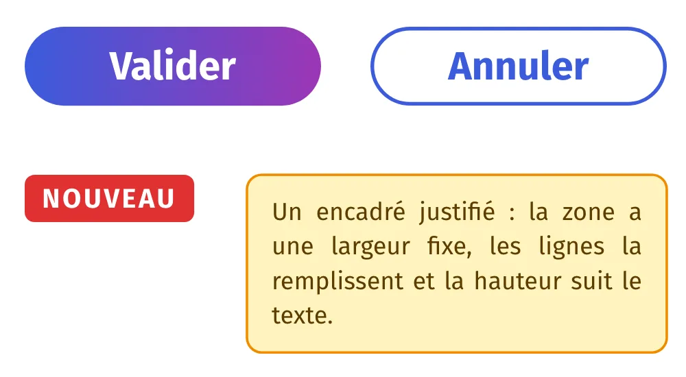
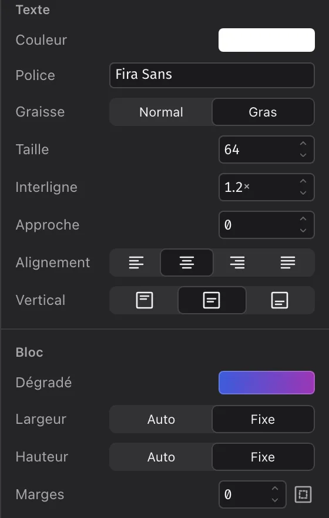

# Faire un bouton, une étiquette ou un encadré

Un calque texte peut porter sa propre zone : un fond, des marges, une bordure et des coins arrondis. Le texte reste
modifiable, et la zone le suit : changez « Valider » en « Enregistrer », le bouton reste centré et bien dessiné.

## 1. Écrire le texte

1. Appuyez sur **T**, cliquez sur le plan de travail, tapez **Valider**, puis **Échap**.
2. Dans la section **Texte** de l'inspecteur : **Couleur** blanc, **Graisse** Gras, **Taille** 64,
   **Alignement** Centre.

## 2. Donner sa taille à la zone

Dans la section **Géométrie**, **Taille** : 480 × 128. La zone passe en largeur et hauteur **Fixe** (section **Bloc**) :
elle ne suit plus le texte.

Puis, dans la section **Texte**, **Vertical** : Milieu. Le texte est centré dans les deux sens.

Vous pouvez aussi tirer les poignées de la zone sur le canevas : la poignée du bas fixe la hauteur. Un bloc ne change
jamais la taille de son texte quand on le redimensionne, même avec ⇧.

## 3. Le fond et les coins

1. Section **Bloc**, **Fond** : choisissez une couleur, ou un dégradé dans le panneau de couleur.
2. Section **Géométrie**, **Rayon** : 64, la moitié de la hauteur, pour une pilule.

## 4. Un bouton secondaire, avec une bordure

Dupliquez le bouton (⌘D), puis :

- **Fond** blanc, **Couleur** du texte bleue ;
- section **Bordure** : couleur bleue, **Épaisseur** 6, **Position** Intérieur, pour que la bordure reste dans la zone.

## Une étiquette qui suit son texte

Pour une étiquette (« NOUVEAU », un nombre, un mot-clé), gardez la largeur et la hauteur **Auto** et réglez des
**Marges** : la zone mesure le texte plus les marges, et s'agrandit en tapant. Le bouton à droite des Marges les règle
séparément en haut et en bas, puis à gauche et à droite (par exemple 12 et 28).

## Un encadré justifié

Pour un paragraphe dans un encadré : tracez la zone avec l'outil Texte en glissant (largeur Fixe), laissez la hauteur
**Auto**, ajoutez des marges, un fond et une bordure, puis **Alignement** Justifié. Les lignes coupées remplissent
la largeur ; la dernière ligne de chaque paragraphe reste à gauche.

## À savoir

- **Le texte qui dépasse** d'une zone de hauteur Fixe reste visible : agrandissez la zone ou repassez la hauteur en Auto.
- **Vectoriser** (⌥⌘O) transforme un bloc en groupe : un rectangle (fond, bordure, coins) sous le tracé du texte.
- **En SVG**, un bloc s'exporte en rectangle + texte ; rouvert, ce ne sont plus qu'un rectangle et un texte séparés.
  Gardez le `.plm` pour continuer à le modifier. Voir [Fidélité du rendu et des exports](../explications/rendu-et-exports.md#les-blocs-de-texte).

Voir aussi : [Écrire et mettre en forme du texte](texte.md), [Couleurs et dégradés](couleurs-et-degrades.md),
[Bordures](../explications/bordures.md).
