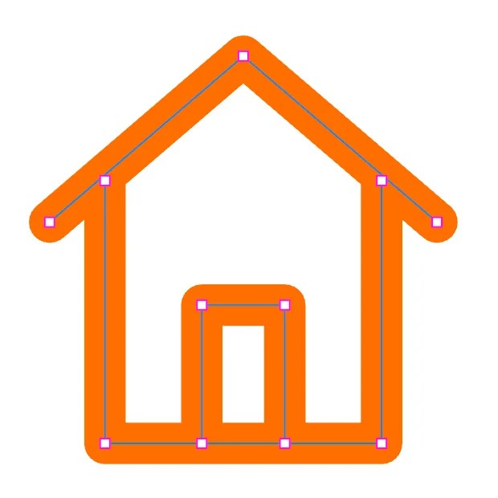
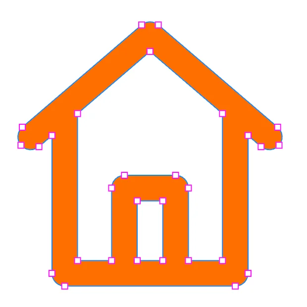

# Transformer une icône au trait en icône pleine

Une icône **au trait** est dessinée par des bordures : son dessin dépend de la bordure, que certains outils
n'agrandissent pas avec l'icône et que les polices d'icônes ne savent pas dessiner. Une icône **pleine** (on dit aussi
*outlined*) est la même forme, faite d'une surface remplie : un tracé sans bordure, ce qu'attendent les bibliothèques
et les polices d'icônes, et qui garde exactement son dessin partout.

| Au trait | Pleine |
|---|---|
|  |  |
| un tracé, bordure orange de 6 px, 11 points | une forme remplie d'orange, sans bordure, avec ses ouvertures |

Pour vous entraîner : **Fichier › Exemples › Pictogrammes**.

## 1. Sélectionner les tracés de l'icône

**Vectoriser le contour** agit sur les tracés eux-mêmes, pas sur un groupe : entrez dans le groupe de l'icône.

1. Double-cliquez sur l'icône : le tracé sous le curseur est sélectionné, et vous êtes dans son groupe.
2. Si l'icône a plusieurs tracés, **⌘A** les sélectionne tous (seulement ceux de ce groupe).

## 2. Vectoriser le contour

**Outils › Vectoriser le contour** (⌥⌘O).

Chaque bordure devient une forme pleine, de la couleur de la bordure, à la même place :

- les **extrémités** (plates, arrondies, carrées) et les **angles** (onglet, arrondis, biseau) sont conservés ;
- là où le trait se chevauche, les surfaces sont fusionnées ; les ouvertures (la porte, l'intérieur de la maison)
  restent des trous ;
- la bordure disparaît : l'export SVG n'écrit plus aucun `stroke`.

La taille affichée dans l'inspecteur augmente de l'épaisseur du trait : c'est maintenant la forme réelle qui compte.

## 3. Réunir les tracés en un seul

Si l'icône avait plusieurs tracés, ils sont devenus plusieurs formes. Avec toutes sélectionnées :
**Outils › Combiner › Union** (⌥⌘U). L'icône n'est plus qu'un seul tracé.

## 4. Exporter

Sélectionnez l'icône, **Fichier › Exporter…** (⌘E), **Contenu : Sélection**, **Format : SVG**.

## À savoir

- **L'épaisseur est figée** : pour la changer, revenez à la version au trait (⌘Z) ou gardez-en une copie.
  Dupliquez l'icône (⌘D) avant de vectoriser si vous voulez garder les deux.
- **Un tracé avec remplissage et bordure** : vectoriser remplace le remplissage par la forme de la bordure. Pour garder
  les deux, dupliquez le tracé (⌘D), vectorisez la copie, puis réunissez les deux par **Union**.
- **Les pointillés** sont vectorisés comme un trait plein.
- **Un texte** vectorisé devient ses lettres, en formes pleines.

Voir aussi : [Combiner des formes](combiner-des-formes.md), [Bordures](../explications/bordures.md).
