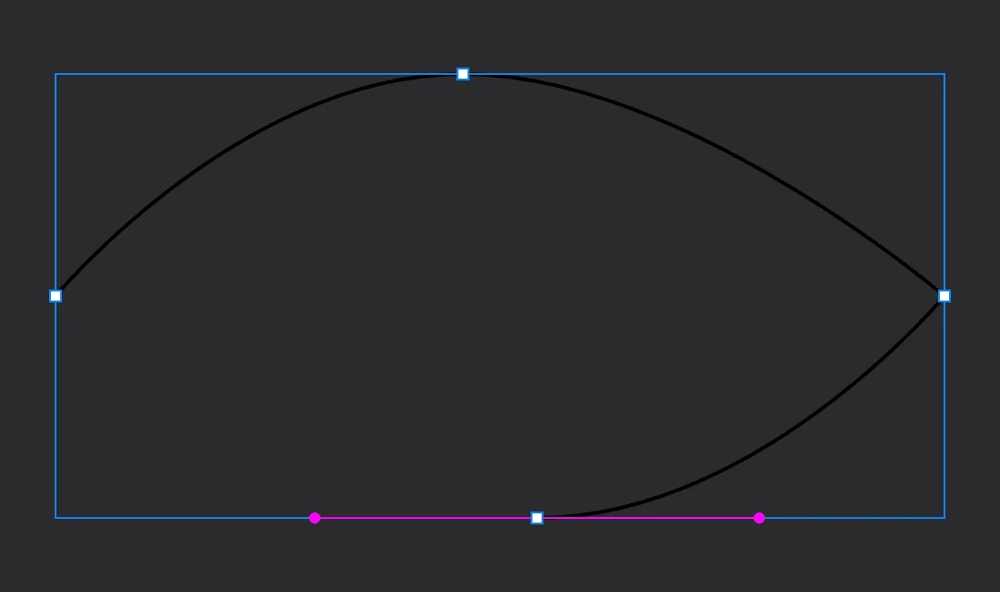
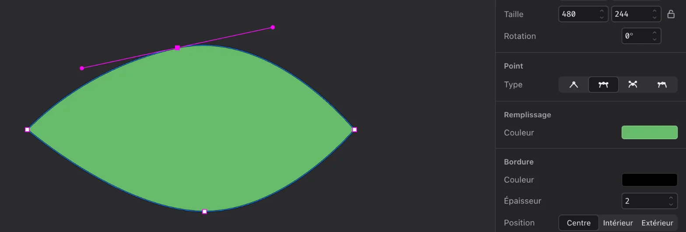

# Dessiner à la plume

Dans ce tutoriel, vous allez dessiner une feuille avec l'outil Plume, puis retoucher sa forme point par point.
Vous saurez ensuite créer n'importe quelle forme faite de lignes droites et de courbes.

Prérequis : avoir suivi [Votre première illustration](01-premiere-illustration.md), ou savoir sélectionner
et colorer une forme.

## 1. Préparer

Ouvrez un nouveau document (⌘N). Inutile de créer un plan de travail cette fois.

## 2. Poser les points

Un tracé est une suite de **points**. Un clic pose un point d'angle ; un clic suivi d'un glisser pose un point
de courbe et tire ses deux **poignées**, qui donnent la direction de la courbe.

Une feuille, ce sont deux pointes et deux courbes :

1. Cliquez l'outil **Plume** dans la barre d'outils (touche V).
2. Cliquez une fois à gauche du canevas : la pointe gauche.
3. Plus haut, à mi-chemin vers la droite, cliquez **et glissez vers la droite** avant de relâcher : un point
   de courbe, qui arrondit le haut de la feuille.
4. Cliquez à droite, à la hauteur du premier point : la pointe droite.
5. Plus bas, à mi-chemin, cliquez **et glissez vers la gauche** : la courbe du bas.

6. Revenez cliquer sur le **premier point** : le tracé se ferme et Plume revient à la Sélection.

## 3. Colorer

Un tracé à la plume n'a pas de remplissage : seulement une bordure noire de 2 px. Dans l'inspecteur, **Remplissage** :

1. ouvrez la pastille ; le remplissage est transparent (0 %) : mettez l'opacité à `100` (champ à droite de **Hex**)
   puis **Retour** ;
2. rouvrez la pastille, tapez `66BB6A` dans **Hex** puis **Retour** : la feuille devient verte.

## 4. Entrer en édition de points

Avec la feuille sélectionnée, appuyez sur **Retour** (ou double-cliquez dessus). Les points apparaissent
sous forme de petits carrés : vous êtes en **édition de points**.

## 5. Affiner une courbe

1. Cliquez sur le point du haut : ses deux poignées apparaissent.
2. Glissez l'une d'elles : l'autre bouge en miroir, la courbe reste lisse.
3. Maintenez **⌥** et glissez une poignée : elle bouge seule, et le point devient anguleux.

Dans l'inspecteur, la section **Point** montre le **type** du point sélectionné :
Droit, Miroir, Déconnecté ou Asymétrique. Cliquez sur **Miroir** pour retrouver une courbe lisse.

## 6. Ajouter et transformer des points

1. Cliquez sur le contour, entre deux points : un point s'ajoute à cet endroit. Glissez-le pour creuser une
   encoche dans la feuille.
2. Double-cliquez sur ce point : il bascule entre point d'angle et point de courbe.
3. Sélectionnez un point et appuyez sur **⌫** : il disparaît, le tracé se referme sans lui.

Annulez avec ⌘Z ce qui ne vous plaît pas.

## 7. Sortir de l'édition

Appuyez sur **Échap**, ou cliquez en dehors de la feuille. Les poignées de sélection habituelles reviennent :
vous pouvez déplacer, redimensionner et faire pivoter la feuille entière.

## Et le crayon ?

L'outil **Crayon** (P) dessine à main levée : glissez, et au relâchement Plume transforme le trait en quelques
courbes lisses, modifiables de la même façon en édition de points.

## Ce que vous avez appris

- **Clic** = point d'angle, **clic-glisser** = point de courbe ; cliquer le premier point ferme le tracé.
- **Retour** ou double-clic entre en édition de points ; **Échap** en sort.
- En édition : clic sur le contour ajoute un point, double-clic sur un point bascule angle/courbe,
  **⌥** libère une poignée, **⌫** supprime le point.

Pour aller plus loin : [Modifier les points d'un tracé](../guides/editer-des-points.md).
